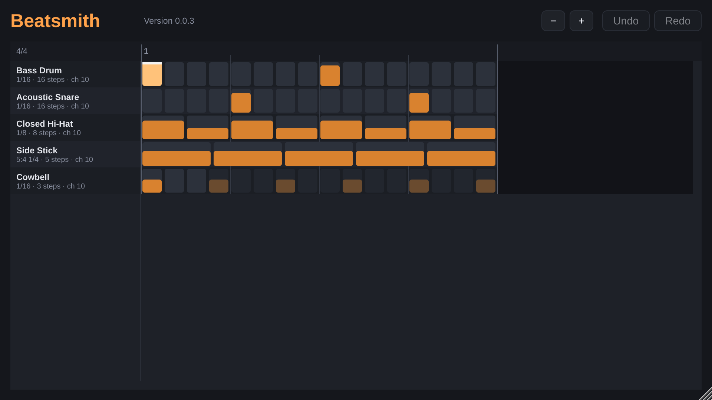
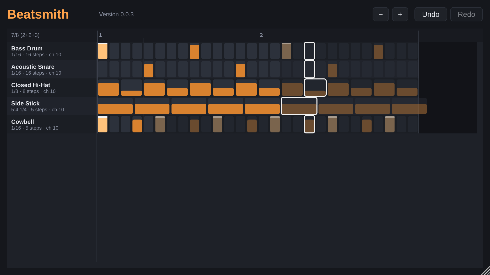

# Beatsmith – User Manual

Beatsmith is a drum step sequencer plug-in (VST3) for Windows. It plays drum patterns in time with your
DAW and sends them as MIDI notes into its track, where a drum plug-in or a hardware drum machine turns
them into sound. Beatsmith itself makes no sound.

> **This manual is a work in progress.** The current version (phase 1b) lets you edit the steps of the
> starting pattern in the step grid; adding lanes and changing their sound, rate and length come in phase 1c.
> Each chapter is filled in when the feature it describes is built; the phase is noted in brackets.

- [Installation](#installation)
- [Where to put it in your DAW](#where-to-put-it-in-your-daw)
- [The starting pattern](#the-starting-pattern)
- [Basic ideas: lanes, steps, patterns, kits](#basic-ideas-lanes-steps-patterns-kits)
- [The window](#the-window)
- [Programming a pattern](#programming-a-pattern)
- [Meters, polymeters and polyrhythms](#meters-polymeters-and-polyrhythms)
- [Feel: swing, micro-timing, humanize](#feel-swing-micro-timing-humanize)
- [Variation: probability and conditional trigs](#variation-probability-and-conditional-trigs)
- [Patterns and switching](#patterns-and-switching)
- [Kits](#kits)
- [Presets](#presets)
- [Automation](#automation)
- [Stuck notes](#stuck-notes)
- [Troubleshooting](#troubleshooting)

---

## Installation

Download `Beatsmith-Windows-vX.Y.Z.zip` from the project's **Releases** page on GitHub (or, for test
builds, from the **Actions** tab → latest successful run → *Artifacts*) and copy `Beatsmith.vst3` to
`C:\Program Files\Common Files\VST3\`. Then let your DAW rescan its plug-ins.

How to check that a download is genuine is described in [SECURITY.md](../SECURITY.md#verifying-a-release).

## Where to put it in your DAW

- **Reaper:** add Beatsmith to a track's FX chain *above* the drum instrument. MIDI flows top to bottom.
- **Bitwig Studio:** put Beatsmith in the drum instrument's **Note FX** section, or as a device before
  the instrument.

To drive a hardware drum machine, send the track's MIDI output to the machine's MIDI port.

MIDI that arrives at Beatsmith (from a keyboard or a MIDI clip on the same track) passes through unchanged,
so you can still play the drum instrument directly. Beatsmith adds its own notes to it.

## The starting pattern

Every new Beatsmith starts with the same five lanes, so there is something to play and edit until lanes can
be added and changed (phase 1c). They use General MIDI drum notes on **MIDI channel 10**, so any
GM-compatible drum plug-in plays them (set the plug-in to receive channel 10, or all channels):

| Lane | GM note | Rate and length | What it plays at first |
|------|---------|-----------------|------------------------|
| Bass Drum | 36 (C1 in Bitwig and Cubase, C2 in Reaper) | 1/16, 16 steps | 1st and 9th sixteenth, the first one accented |
| Acoustic Snare | 38 | 1/16, 16 steps | 5th and 13th sixteenth |
| Closed Hi-Hat | 42 | 1/8, 8 steps | every eighth, alternating loud and soft |
| Side Stick | 37 | 5:4 1/4, 5 steps | five even notes per 4/4 bar – a quintuplet against the beat |
| Cowbell | 56 | 1/16, 3 steps | the first of every three sixteenths – three against four |

The pattern is one bar long, follows your DAW's time signature and starts again at every bar line. Edit it
as you like; your changes are saved with the project.

## Basic ideas: lanes, steps, patterns, kits

- A **lane** is one drum sound: it plays one MIDI note on one MIDI channel. Each lane has its own row of
  **steps**, its own **rate** (how long one step lasts: 1/16, an eighth-note triplet, five in the time of
  four quarters …) and its own **length** (how many steps before it starts over, 1 to 128).
- A step that plays is a **trig**. A trig has a velocity; an **accented** trig plays at the lane's accent
  velocity (127 by default) instead.
- The **pattern** is all lanes together, with a length in bars. When the pattern starts again, all lanes start
  again from their first step – so a lane shorter than the pattern repeats inside it, and steps of a lane
  longer than the pattern never come round. *(Phase 1c: other ways for lanes to realign.)*
- A **kit** is the set of lane names, notes and channels for one drum instrument. *(Phase 5: saving your own
  kits.)*

## The window

- **Header:** **−** and **+** zoom the grid out and in; **Undo** and **Redo** step through your changes.
- **Lane names** (left): the drum sound of each lane, and below it the lane's rate, length and MIDI channel.
- **Ruler** (top): the bar numbers, and in the corner the time signature the grid shows, with its beat grouping –
  e.g. *7/8 (2+2+3)*.
- **Step grid:** every lane's steps on one time axis. A step's width is its real length, so lanes with
  different rates line up the way they sound: in the picture, the five side-stick steps fill the same bar as
  sixteen kick steps. Strong lines are bar lines; fainter lines mark the beat groups.

In the grid:

- An empty step is dark; a trig is filled from the bottom, the higher the louder. An accented trig is full,
  brighter and has a white top edge.
- A lane shorter than the pattern repeats: its own steps are bright, the **repeats** faint. You can edit
  either – a repeat *is* the same step.
- Steps after the end of the pattern never play; that part of the grid is darker and its steps greyed out.
- While the DAW plays, a white frame on every lane shows the step playing at that moment.

Scroll with the mouse wheel (lanes) and Shift + mouse wheel (time), or with the scroll bars. Ctrl + mouse
wheel zooms around the mouse position. Resize the window by dragging its bottom-right corner. Beatsmith
remembers the window size and zoom in your project.

## Programming a pattern

| To … | Do this |
|------|---------|
| set or clear a trig | click the step |
| set or clear many steps | press on a step and drag sideways along the lane. Starting on an empty step sets every step you drag over; starting on a trig clears them |
| make a trig louder or softer | press on the trig and drag up (louder) or down (softer). The fill shows the velocity as you drag. This also removes an accent, so you hear the new velocity |
| accent a step | Shift-click or right-click it. An empty step becomes an accented trig; clicking an accented trig again removes the accent |
| undo or redo | **Undo** / **Redo**, or Ctrl+Z and Ctrl+Shift+Z (or Ctrl+Y) |

The first few pixels of mouse movement decide what a drag does: mostly sideways paints, mostly up and down
changes the velocity (on an empty step, an up-and-down drag does nothing). Each click or drag is one undo
step. Changes play at once, also while the DAW is playing.

New trigs get the lane's default velocity (100). Notes are a 1/32 note long by default.

Beatsmith keeps the last 100 changes for undo, until the project is closed or reloaded. Your pattern is saved
with the DAW project.

*(Phase 1c: adding and removing lanes, choosing their note, channel, rate, length and note length, mute and
solo, and the Audition button for programming while the DAW is stopped.)*

## Meters, polymeters and polyrhythms

The grid always shows the bars the pattern plays in. Here the DAW is set to 7/8 and the pattern is two bars
long:

- The ruler says *7/8 (2+2+3)*: each bar has seven eighths, felt as two, two and three. The faint lines inside
  each bar mark those groups.
- The kick and snare lanes have 16 steps, but a bar of 7/8 holds only 14 sixteenths: the lanes run on across
  the bar line and start over after their 16 steps (the faint repeats in bar 2). At the end of the two-bar
  pattern – after 28 sixteenths – all lanes start again together.
- The cowbell lane has 5 steps: its repeats show how it drifts against the bar (a polymeter).
- The side stick plays five even steps per four quarter notes, whatever the meter (a polyrhythm).

While the DAW is stopped, the grid shows the last time signature the DAW reported (saved with the project;
4/4 before Beatsmith has ever played).

*(Phase 1c)* To be written, with examples for:

- playing in the DAW's time signature, and overriding it per pattern;
- beat groupings (e.g. 7/8 as 2+2+3 or 3+2+2) and what they change;
- lanes of different length (a 5-step hi-hat against a 16-step kick);
- lanes of different rate (triplets, dotted values, free tuplets such as 5 in 4);
- when lanes realign (song start, pattern restart, every N bars);
- what happens when the DAW's time signature changes during a pattern.

## Feel: swing, micro-timing, humanize

*(Phase 2)* To be written.

## Variation: probability and conditional trigs

*(Phase 3)* This chapter will explain every condition with a short description, a diagram of which
passes play, and a musical example. Planned structure:

1. Probability – a chance per trig.
2. What a trig condition is, and how passes are counted per lane.
3. A:B – play on pass A of every B passes (1:2, 2:4, 4:4 …).
4. FILL and NOT FILL – the Fill button, momentary and latched.
5. FIRST and NOT FIRST.
6. PRE and NOT PRE – depend on the previous condition in the same lane.
7. NEI and NOT NEI – depend on the neighbouring lane.
8. Combining conditions with probability; recipes (e.g. a crash on the first bar of every four, a
   snare roll only in fills, hi-hat variations that never repeat exactly).
9. Ratchets and flams.

## Patterns and switching

*(Phase 4)* To be written.

## Kits

*(Phases 1 and 5)* To be written: the General MIDI default kit, changing a lane's note and channel,
saving and loading your own kits, where kit files are stored.

## Presets

*(Phase 5)* To be written.

## Automation

*(Phase 1 onwards)* To be written: which controls the DAW can automate.

## Stuck notes

Beatsmith ends every note it starts: at the end of its note length, before the same note plays again, and
at once when you stop, loop or jump in the DAW or bypass the plug-in – also when a lane's note or channel
was changed in between. If a note ever hangs, please report it as a bug.

## Troubleshooting

- **Ctrl+Z does not undo in Beatsmith.** Many DAWs keep keyboard shortcuts for themselves. Use the **Undo**
  and **Redo** buttons, or let the DAW pass keys to the plug-in (in Reaper: the FX window's option to send
  all keyboard input to the plug-in). Keys Beatsmith does not use, such as the space bar, always go back to the
  DAW.

- **Nothing plays.** Beatsmith plays only while the DAW's transport runs. Check that the drum instrument
  receives MIDI channel 10 (or all channels) and that Beatsmith sits before it (see
  [Where to put it in your DAW](#where-to-put-it-in-your-daw)).
- **After a time-signature change, the first bar sounds slightly late.** DAWs tell plug-ins about a new time
  signature only from the next audio block on; Beatsmith then plays the missed notes at once, a few
  milliseconds late. A smaller audio buffer makes this shorter.
- **Starting playback behind a time-signature change, the pattern starts in the wrong place.** Beatsmith
  learns where time-signature changes are while playing through them. If you start behind a change it has
  not played through yet, it counts bars as if the current time signature had applied since the song start,
  until playback passes the change once.
